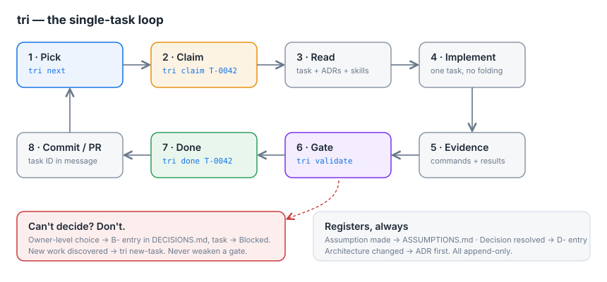

# tri

Delivery method plugin: **T**ask register + **R**egisters (decisions, assumptions, ADRs) + **I**ncrement evidence. Extracted from a production architecture workspace; in the family of GSD and spec-kit, with two differences: an append-only decision/assumption register ("never choose silently") and an evidence-gated definition of done.

State is plain markdown under `tri/` in your project, merged through git. No server, no daemon. One zero-dependency Node engine enforces mechanics; host adapters orchestrate workers and Git worktrees.

## Install

**Standard setup (every developer, once):**

```bash
git clone git@github.com:Amerkhorsheed/tri.git ~/.tri
```

Claude Code — register the marketplace and install:

```bash
claude plugin marketplace add Amerkhorsheed/tri
claude plugin install tri@tri
```

(or ad hoc: `claude --plugin-dir ~/.tri`)

The `~/.tri` clone is the shared convention: project docs and AGENTS.md sections reference `node ~/.tri/scripts/tri.mjs`, so every developer and CI job resolves the same path. Update with `git -C ~/.tri pull`.

Codex — install the native plugin and worker profile:

```bash
codex plugin marketplace add Amerkhorsheed/tri
codex plugin add tri@tri
~/.tri/scripts/install-codex-agent.sh
```

Pi — install the package (skill, `/tri:*` commands, selectable questions, and cancellable parallel worker tool):

```bash
pi install git:github.com/Amerkhorsheed/tri@v3.1.0
```

Gemini CLI — install the extension, which bundles commands, the skill, and `tri-worker`. Native subagents are experimental and must be enabled with `{"experimental":{"enableAgents":true}}` in Gemini settings:

```bash
gemini extensions install https://github.com/Amerkhorsheed/tri
```

Antigravity reads the same `AGENTS.md`/Agent Skills surfaces. Its current adapter deliberately reports sequential because no programmable worker interface has been verified; it never labels that fallback parallel. Generic agents continue to work through the project's `AGENTS.md` section and the same engine.

**Per project:** new project → `/tri:init [profile]`. Existing task tree → write a `tri.config.json` adapter (see "Adopting an existing task tree") and add the AGENTS.md section by hand or via init.

## How it works, visually




Full walkthrough with commands, batch runs, and profiles: [docs/guide.html](docs/guide.html) (self-contained — open in any browser). Host capability and worker-launch guarantees: [docs/host-adapters.md](docs/host-adapters.md).

## Commands

| Command | Does |
|---|---|
| `/tri:go [focus]` | **Start here.** Say what you want to work on; reads state, picks the right command below, runs it |
| `/tri:ship <area>` | Whole pipeline: scope → interview → write specs → one go-ahead → implement unattended |
| `/tri:init [profile]` | Scaffold `tri/` workspace + `tri.config.json` + AGENTS.md section. Profiles: `lite`, `standard` (default), `strict` |
| `/tri:plan <spec>` | Decompose a spec into tasks with real (not ceremonial) dependency edges |
| `/tri:next [ID]` | Show ready tasks; claim and start one |
| `/tri:done <ID>` | Structured-evidence-gated completion |
| `/tri:status` | Counts, claims, ready frontier, critical path |
| `/tri:adr <text>` | Write an ADR from the template |
| `/tri:run [scope]` | Automatic declared-safe scheduling across sequential workers, parallel subagents, or native teams; dynamically leased and resumable via `.tri/run.json` |
| `/tri:clarify [target]` | Interrogate and refine what is unclear — a task, a phase, or a decision you doubt. Batches questions for specs, goes one at a time for decisions. Writes results into files and registers |
| `/tri:visualize [target]` | Interactive HTML board (phase lanes, dependencies, critical path) written to gitignored `.tri/`, opened for discussion |
| `/tri:sync` | Fetch remote branches and reserve task/register identifiers allocated off default branch |
| `/tri:evidence <ID> --name <check> -- command` | Capture status, output hash, engine/runtime context, and check identity |
| `/tri:companions --check` | Check configured companion files and invoke maintenance hook |
| `/tri:doctor` | Warn on governing-document drift and remote identifier collisions |
| `/tri:rebaseline` | Drive ordered charter-to-task re-baseline layers |

Direct script use (what agents and CI run):

```bash
node scripts/tri.mjs <init|new-task|new-adr|register|validate|next|claim|claim-token|release|done|status|graph|visualize|run-state|verify-scope|claim-ref|sync|evidence|companions|doctor|rebaseline|meta>
node scripts/tri-host.mjs [claude|codex|pi|gemini|antigravity|generic] --json
```

## Branch and PR workflows

`workflow` controls branch/PR mechanics. TRI itself now runs read-only Git inspection for remote identifier reservations (`sync`, allocation, `validate --remote`, and `doctor`); command/skill layer still owns branch creation, commits, pushes, and PRs.

## Batch execution vs the gates

`/tri:run` chooses maximal declared-safe parallelism automatically. `tri-host.mjs` declares the host capability, and the scheduler combines it with dependency readiness and exact `Expected files`, leases independent chains up to capacity four, and records adapter, backend, requested mode, and actual mode. Claude uses `tri-worker` Agents/teams, Codex uses native `spawn_agent`, Pi uses cancellable child processes, and Gemini uses its bundled experimental subagent. Every worker runs in a distinct Git worktree. Missing or overlapping scopes serialize rather than becoming merge conflicts. Each worker commit must pass `verify-scope`, structured evidence, project checks, and `validate` before the orchestrator cherry-picks it onto one integration branch. Contract/shared-interface changes remain separate review PRs. Antigravity and unknown hosts currently fail safe to sequential; no host may silently report a fallback as parallel.

## Parallel developers

Claiming is **dynamic and pull-based**. An active task owns the exact remote ref `refs/heads/tri/claims/<task-id>`. `claim-token` creates a unique same-base Git object; pushing it with an empty `--force-with-lease` expectation means competing creation cannot both succeed. Branch names are never ownership evidence. Local manifests record owner and exact write files/directories (directories end in `/`; globs are rejected), and TRI refuses ancestor/exact overlap. Batch runs claim only work becoming active, not the whole future queue.

## Commands continue, they don't hand off

A command that finishes with exactly one sensible next step takes it, announcing each hop in a line. An ADR that lands re-specifies the tasks waiting on it; a clarification that resolves claims the task and starts. It stops only at a real gate: the `/tri:ship` specification gate, a decision that is the owner's, a red validator after a genuine fix attempt, or anything irreversible. Ambiguity is resolved with a question, not a halt.

Writing decision and assumption entries is a capability every command has, not something you invoke — which is why there is no `decide` command.

## Before work starts

TRI v3 requires Git after `init`. Engine preflight refuses malformed config, detached/conflicted state, dirty tracked state when starting new work, and starting `branch-pr` work on the default branch. New TRI-native workspaces use decentralized random task/ADR/register IDs, removing global-counter races; existing numeric IDs remain readable and foreign workspaces can explicitly retain sequential allocation. Branch-PR claims require exact remote claim refs. `tri.mjs meta` exposes the authoritative command/config contract used by consistency checks.

## Batch state and recovery

`run-state` is the mechanical scheduler record: `--start` with scope/mode/queue/`--adapter`, `--lease <worker>` for dynamic assignments, `--done`/`--blocked`, and `--finish`. It records host adapter, worker backend, capacity, actual mode, active workers, assignments, and timing. Bare or `--json` state resumes a killed session. `init` automatically ignores `.tri/`; the state is never hand-edited.

## Profiles

| | lite | standard | strict |
|---|---|---|---|
| Task fields | ~8 | ~18 | ~28 |
| Done gate | valid state/dependencies | + successful structured evidence and summary | + required checks and environment match |

## Adopting an existing task tree

tri reads foreign task formats through config instead of rewriting files. Example — a repo with `tasks/phase-*/TASK-NNNN.md`, five statuses, and evidence records elsewhere:

```json
{
  "version": 2,
  "profile": "strict",
  "taskDir": "tasks",
  "idStrategy": "sequential",
  "idPrefix": "TASK-",
  "idWidth": 4,
  "statuses": ["Planned", "Ready", "Blocked", "In Progress", "Done"],
  "evidenceDir": "docs/testing/evidence",
  "taskTemplate": "tasks/TASK_TEMPLATE.md",
  "companionFiles": ["tasks/README.md", "tasks/validate-tasks.mjs"],
  "companions": [{"path": "tasks/README.md", "strategy": "check"}],
  "companionHooks": {"new-task": ["node", "scripts/update-companions.mjs"]},
  "adrDir": "tri/adr",
  "decisionFiles": ["tri/DECISIONS.md", "tri/ASSUMPTIONS.md"],
  "runtimeProbes": [["php", "--version"]],
  "expectedEnvironment": {"node": "v24"},
  "requiredChecks": ["test", "lint"],
  "requireRemoteReservations": true,
  "claimScope": {"directory": ".tri/claims", "responsibilities": ["admin"]},
  "defaultBranch": "main",
  "baseBranch": "dev"
}
```

`taskTemplate` makes `new-task` use the project's template and fail on missing required sections. `idStrategy` is `random` for TRI-native v3 workspaces; `sequential` preserves foreign numeric validators and legacy remote reservation checks. Unknown config keys fail unless namespaced `x-*`; writable paths must stay inside the repository. `requiredChecks`, runtime probes, and expected environment drive structured evidence gates. Evidence stores command metadata, status, output byte count/hash, runtime, and TRI version—not raw output. Companion hooks, doctor, Withdrawn, and Unrevised lifecycle support remain available.

When creating a task, `--phase NN` targets `phase-NN`. If an existing task tree has exactly one suffixed directory such as `phase-12-mobile`, tri reuses it; `--phase NN-label` targets that exact label. Multiple suffixed matches, or a canonical directory alongside a suffixed match, fail instead of choosing silently. A phase with no match gets the canonical `phase-NN` directory.

Drop that in as `tri.config.json` and every command works against the existing tree byte-for-byte unchanged (claims add an `## Assignee` section on first claim; nothing else is rewritten). Verified against a production workspace of 338 governed task files: `validate` clean, frontier and critical-path output matching an independent analysis.

## Tests and consistency

```bash
node scripts/test-tri.mjs && node scripts/test-v3.mjs && node scripts/test-adapters.mjs && node scripts/check-consistency.mjs
```

The consistency check fails when a change reaches one artifact but not its companions — an undocumented command or config key, a version without a changelog entry, a stale test count, a broken link. See [CONTRIBUTING.md](CONTRIBUTING.md) for what must move together.

79 behavioral tests cover legacy adapters plus v3 decentralized IDs, engine-owned ADR/register creation, config containment, structured evidence privacy, exact claims, dynamic concurrent leasing, host capability fallbacks, real overlapping worker processes, native package surfaces, Withdrawn graph semantics, and board/graph visualization.
