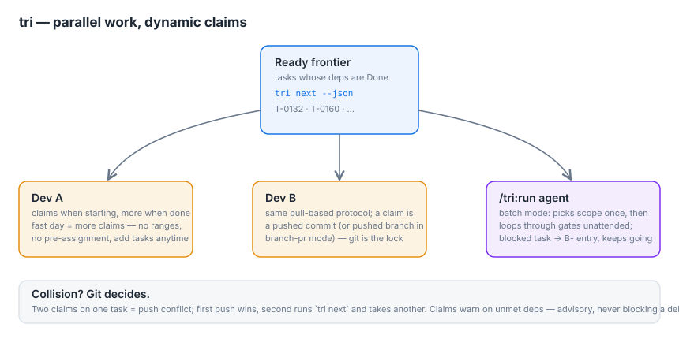

# tri

Delivery method plugin: **T**ask register + **R**egisters (decisions, assumptions, ADRs) + **I**ncrement evidence. Extracted from a production architecture workspace; in the family of GSD and spec-kit, with two differences: an append-only decision/assumption register ("never choose silently") and an evidence-gated definition of done.

State is plain markdown under `tri/` in your project, merged through git. No server, no daemon. One zero-dependency Node script does all mechanics.

## Install

**Standard setup (every developer, once):**

```bash
git clone git@github.com:Amerkhorsheed/tri.git ~/.tri
```

Claude Code — register the marketplace and install:

```bash
claude plugin marketplace add Amerkhorsheed/tri
claude plugin install tri@tri
```

(or ad hoc: `claude --plugin-dir ~/.tri`)

The `~/.tri` clone is the shared convention: project docs and AGENTS.md sections reference `node ~/.tri/scripts/tri.mjs`, so every developer and CI job resolves the same path. Update with `git -C ~/.tri pull`.

Codex / any other agent: works through the project's `AGENTS.md` — `/tri:init` appends a "TRI Method" section that instructs any agent to follow the same loop and run the same script from `~/.tri`. No Claude-specific machinery required.

**Per project:** new project → `/tri:init [profile]`. Existing task tree → write a `tri.config.json` adapter (see "Adopting an existing task tree") and add the AGENTS.md section by hand or via init.

## How it works, visually




Full walkthrough with commands, batch runs, and profiles: [docs/guide.html](docs/guide.html) (self-contained — open in any browser).

## Commands

| Command | Does |
|---|---|
| `/tri:go [focus]` | **Start here.** Say what you want to work on; reads state, picks the right command below, runs it |
| `/tri:ship <area>` | Whole pipeline: scope → interview → write specs → one go-ahead → implement unattended |
| `/tri:init [profile]` | Scaffold `tri/` workspace + `tri.config.json` + AGENTS.md section. Profiles: `lite`, `standard` (default), `strict` |
| `/tri:plan <spec>` | Decompose a spec into tasks with real (not ceremonial) dependency edges |
| `/tri:next [T-NNNN]` | Show ready tasks; claim and start one |
| `/tri:done <T-NNNN>` | Evidence-gated completion |
| `/tri:status` | Counts, claims, ready frontier, critical path |
| `/tri:adr <text>` | Write an ADR from the template |
| `/tri:run [scope]` | Autonomous batch execution — asks scope and execution model once (sequential / parallel subagents / team, recommended by batch shape), then runs task after task through the gates without checkpoints; resumable via `.tri/run.json` |
| `/tri:clarify [target]` | Interrogate and refine what is unclear — a task, a phase, or a decision you doubt. Batches questions for specs, goes one at a time for decisions. Writes results into files and registers |
| `/tri:visualize [target]` | Interactive HTML board (phase lanes, dependencies, critical path) written to gitignored `.tri/`, opened for discussion |
| `/tri:sync` | Fetch remote branches and reserve task/register identifiers allocated off default branch |
| `/tri:evidence <T-NNNN> -- command` | Capture command output plus structured runtime context |
| `/tri:companions --check` | Check configured companion files and invoke maintenance hook |
| `/tri:doctor` | Warn on governing-document drift and remote identifier collisions |
| `/tri:rebaseline` | Drive ordered charter-to-task re-baseline layers |

Direct script use (what agents and CI run):

```bash
node scripts/tri.mjs <init|new-task|validate|next|claim|release|done|status|graph|visualize|run-state|sync|evidence|companions|doctor|rebaseline>
```

## Branch and PR workflows

`workflow` controls branch/PR mechanics. TRI itself now runs read-only Git inspection for remote identifier reservations (`sync`, allocation, `validate --remote`, and `doctor`); command/skill layer still owns branch creation, commits, pushes, and PRs.

## Batch execution vs the gates

Like GSD's execute-phase or spec-kit's implement, `/tri:run` chews through many tasks in one go. In branch-pr workflow a sequential run uses one run branch with an atomic commit per task and one PR per phase boundary (per-task PRs would break intra-run dependency chains — the next task needs the previous one's unmerged code); parallel subagent runs keep per-task PRs; contract-touching tasks get extracted to their own PR for review. The execution model is chosen at start and recommended by batch shape: sequential for small batches or overlapping files, parallel subagents for ≥ 4 file-disjoint tasks, and a team of agents (Claude Code only) for large disjoint batches — teams share context and can re-plan mid-run; subagents stay isolated; on hosts without teams, degrade to parallel subagents. The loop's safety is mechanical, not vigilance-based: a task can't pass `done` with empty Evidence, `validate` failure halts the run, a missing owner decision becomes a Blocked task plus register entry while the run continues elsewhere, and `run-state --start` rejects unknown modes and warns when a non-sequential mode queues tasks declaring overlapping Expected files. Speed comes from never pausing between good tasks; safety from being unable to coast past a bad one.

## Parallel developers

Claiming is **dynamic and pull-based** — no pre-assigned ranges. Claim when you start, claim more when you finish; a fast day means more claims, and adding tasks mid-flight is normal (`new-task`). Every claim also writes `.tri/claims/<task-id>.json` with owner, primary/covered/may-cover tasks, responsibilities, and related ADRs. TRI refuses exact scope overlap and never treats branch names as ownership evidence. A pushed manifest plus verified remote ref is the visible branch-pr claim; missing or malformed scope fails closed. Consistency comes from git: simultaneous claims resolve at push (first wins, second picks the next ready task). Dependency warnings on claims are advisory — the tool never blocks a split you chose deliberately.

## Commands continue, they don't hand off

A command that finishes with exactly one sensible next step takes it, announcing each hop in a line. An ADR that lands re-specifies the tasks waiting on it; a clarification that resolves claims the task and starts. It stops only at a real gate: the `/tri:ship` specification gate, a decision that is the owner's, a red validator after a genuine fix attempt, or anything irreversible. Ambiguity is resolved with a question, not a halt.

Writing decision and assumption entries is a capability every command has, not something you invoke — which is why there is no `decide` command.

## Before work starts

Every command that writes to the repository runs a preflight matched to what it changes:

- **Tier 1, all of them** — stop on a dirty worktree, a rebase or merge in progress, or a detached HEAD; under `branch-pr`, cut the work branch from the default branch before the first commit and never commit onto an unrelated task's branch.
- **Tier 2, anything allocating a shared identifier** (a decision number, an ADR number, a task id) — `git fetch` first. An identifier chosen from a stale ref may already be taken, and the collision is invisible until merge.
- **Tier 3, anything claiming work** — `git ls-remote --heads origin`. A branch named for the task is a claim; a pushed `run/*` or `ship/*` branch claims its whole queue.

This is what keeps two features out of one branch, specifications and code off the default branch, and two developers from allocating the same number.

## Batch state and recovery

`run-state` is the mechanical record of a batch: `--start` with a scope, execution model (`sequential|parallel|team`) and queue; `--done`/`--blocked` after each task; `--finish` at the end. Bare `run-state` prints what remains, so a session killed mid-batch resumes exactly where it stopped rather than relying on the agent having remembered. The file lives in gitignored `.tri/` and is never hand-edited.

## Profiles

| | lite | standard | strict |
|---|---|---|---|
| Task fields | ~8 | ~18 | ~28 |
| Done gate | `validate` passes | + Evidence section filled | + evidence record file in `tri/evidence/` |

## Adopting an existing task tree

tri reads foreign task formats through config instead of rewriting files. Example — a repo with `tasks/phase-*/TASK-NNNN.md`, five statuses, and evidence records elsewhere:

```json
{
  "profile": "strict",
  "taskDir": "tasks",
  "idPrefix": "TASK-",
  "idWidth": 4,
  "statuses": ["Planned", "Ready", "Blocked", "In Progress", "Done"],
  "evidenceDir": "docs/testing/evidence",
  "taskTemplate": "tasks/TASK_TEMPLATE.md",
  "companionFiles": ["tasks/README.md", "tasks/validate-tasks.mjs"],
  "companions": [{"path": "tasks/README.md", "strategy": "check"}],
  "companionHooks": {"new-task": ["node", "scripts/update-companions.mjs"]},
  "adrDir": "tri/adr",
  "decisionFiles": ["tri/DECISIONS.md", "tri/ASSUMPTIONS.md"],
  "runtimeProbes": [["php", "--version"]],
  "expectedEnvironment": {"node": "v24"},
  "requireRemoteReservations": true,
  "claimScope": {"directory": ".tri/claims", "responsibilities": ["admin"]},
  "defaultBranch": "main",
  "baseBranch": "dev"
}
```

`taskTemplate` makes `new-task` write the project's own template and fails if required sections are missing; TRI preserves template-owned fields and only replaces Phase/Dependencies when corresponding CLI options are supplied. `companionFiles` remains a legacy check-only list; `companions` supports path checks with strategy `check`, while unsupported strategies must use hooks. `companionHooks` uses argv arrays after `new-task`, `done`, `validate`, or `companions --check`. `runtimeProbes` and `expectedEnvironment` make evidence show declared runtime context; malformed probes and failed probes stop evidence capture. `sync` fetches remote branches and reserves identifiers not yet on the default branch; configured remote reservation failures stop allocation. `doctor` reports dangling ADR references and remote collisions as warnings. `Withdrawn` remains in registers but never enters frontier. `Specification status` defaults old tasks to `Specified`; generated tasks start `Unrevised`.

When creating a task, `--phase NN` targets `phase-NN`. If an existing task tree has exactly one suffixed directory such as `phase-12-mobile`, tri reuses it; `--phase NN-label` targets that exact label. Multiple suffixed matches, or a canonical directory alongside a suffixed match, fail instead of choosing silently. A phase with no match gets the canonical `phase-NN` directory.

Drop that in as `tri.config.json` and every command works against the existing tree byte-for-byte unchanged (claims add an `## Assignee` section on first claim; nothing else is rewritten). Verified against a production workspace of 338 governed task files: `validate` clean, frontier and critical-path output matching an independent analysis.

## Tests and consistency

```bash
node scripts/test-tri.mjs && node scripts/check-consistency.mjs
```

The consistency check fails when a change reaches one artifact but not its companions — an undocumented command or config key, a version without a changelog entry, a stale test count, a broken link. See [CONTRIBUTING.md](CONTRIBUTING.md) for what must move together.

63 behavioral tests covering init, ID allocation, validation defects (missing deps, bad status, duplicate IDs, cycles), frontier computation, claim/release/force, evidence gates per profile, Withdrawn and Unrevised lifecycle behavior, phase directory compatibility and conflict refusal, graph metrics, remote reservation failures/collisions, canonical doctor checks, the post-2.1.0 hardening regressions, and execution-model mode validation with Expected-files overlap warnings.
